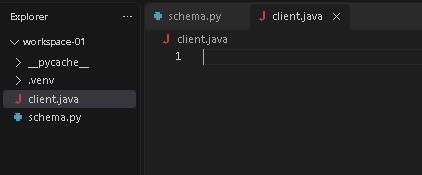
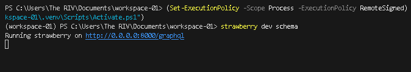
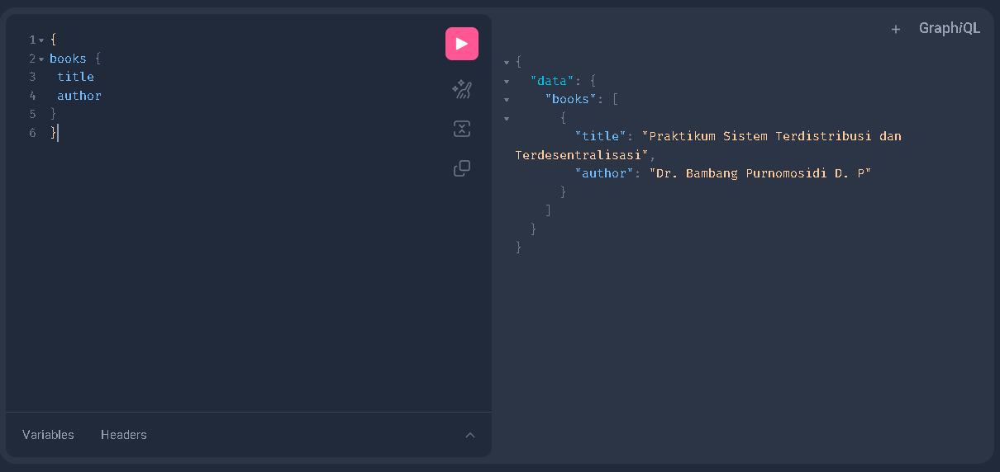
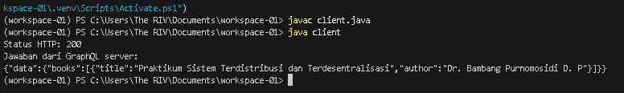

[Kembali](README.md)

PRAKTIKUM SISTEM TERDESENTRALISASI DAN TERDISTRIBUSI <br>
Minggu 02<br>
Nama: Basilius Rivalno<br>
NIM: 255410027<br>
Dosen: Dr. Bambang Purnomosidi D. P.<br>

tugas 2 <br>
 1. Membuat client dengan bahasa pemrograman java
 

 2. Kode java untuk meminta query dari server
 
```import java.net.URI; //URI akan membantu menunjukkan alamat server yang akan diakses
import java.net.http.HttpClient; //HttpClient akan membantu membuat permintaan ke server
import java.net.http.HttpRequest; //HttpRequest akan membantu menyusun permintaan ke server
import java.net.http.HttpResponse; //HttpResponse akan membantu menerima jawaban dari server

public class client {
    public static void main(String[] args) {

        //alamat server yang akan diakses
        String url = "http://localhost:8000/graphql";

        //untuk meminta data buku
        String query = """
            {
                books {
                    title
                    author
                }
            }
            """;

        // Membuat permintaan server dalam format JSON
        String body = "{\"query\":\""
                + query.replace("\\", "\\\\")
                       .replace("\"", "\\\"")
                       .replace("\n", "\\n")
                + "\"}";

        try {
            // Membuat HTTP client agar dapat mengirim permintaan ke server
            HttpClient client = HttpClient.newHttpClient();

            // Membuat HTTP request agar dapat mengirim permintaan ke server
            HttpRequest request = HttpRequest.newBuilder()
                    .uri(URI.create(url))
                    .header("Content-Type", "application/json")
                    .POST(HttpRequest.BodyPublishers.ofString(body))
                    .build();

            // Mengirim permintaan ke server dan menerima jawaban dari server
            HttpResponse<String> response = client.send(
                    request,
                    HttpResponse.BodyHandlers.ofString()
            );
            
            // Menampilkan status HTTP dan jawaban dari server
            System.out.println("Status HTTP: " + response.statusCode());
            System.out.println("Jawaban dari GraphQL server:");
            System.out.println(response.body());

        //menampilkan pesan kesalahan jika terjadi error saat mengakses server
        } catch (Exception e) {
            System.out.println("Terjadi kesalahan saat mengakses server.");
            System.out.println("Pesan: " + e.getMessage());
        }
    }
}
```
3. Menjalankan server Strawberry


4. Tampilan server 


5. Hasil pada client setelah meminta query dari server

hasilnya menunjukkan bahwa dua bahasa pemrograman berbeda yaitu python dan java dapat berkomunikasi melalui graphQL