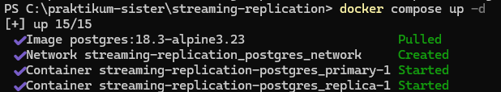
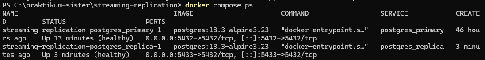

[Kembali](README.md) 
Praktikum Sistem Terdistribusi Dan Terdesentralisasi  
Modul 04 
Nama: Basilius Rivalno 
NIM: 255410027 
Dosen: Dr. Bambang Purnomosidi D. P 

<b>Menjalankan Docker Compose</b>

1. Menjalankan Docker Compose Up pada terminal

Docker Compose Up berfungsi untuk  mengaktifkan image yang terdiri atas lebih
dari 1 dengan menggunakan konfigurasi docker-compose.yaml

2. Memeriksa status container atau image menggunakan Docker Compose Ps

gambar menunjukkan dua instance dari PostgreSQL 18.3 dalam status Healthy

