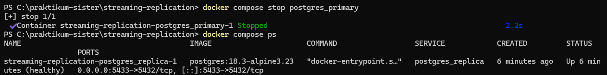
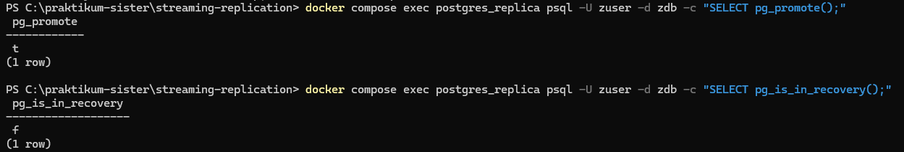
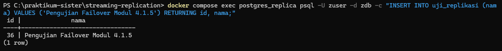
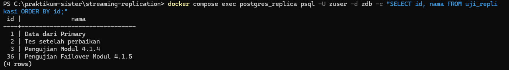
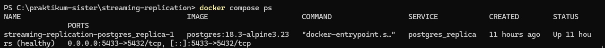

[Kembali](README.md) 
Praktikum Sistem Terdistribusi Dan Terdesentralisasi  
Modul 04 
Nama: Basilius Rivalno 
NIM: 255410027 
Dosen: Dr. Bambang Purnomosidi D. P 

<b>High Availability</b> 
Jika salah satu atau primary server dalam kondisi down, maka salah satu replica bisa menggantikannya

1. Mematikan atau menghentikan primary server yang sudah ada

2. Mempromosikan server replica agar menjadi primary

Server replica yang telah dipromosikan kondisi nya telah berubah dari yang hanya bisa akses read menjadi read and write

3. Menuliskan data pada replica yang sudah menjadi primary

4. Mengecek apakah data sudah terisi pada primary baru

5. Mengecek status container

statsu menunjukkan server replica sudah dipromosikan menjadi server primary dan memiliki kondisi healthy

