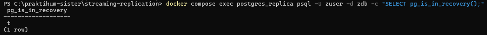
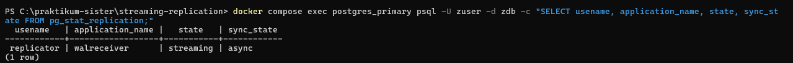
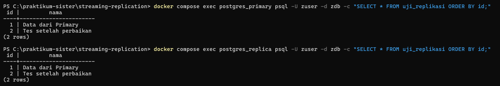
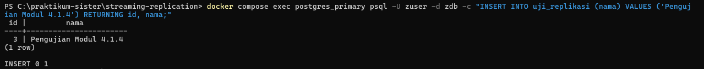
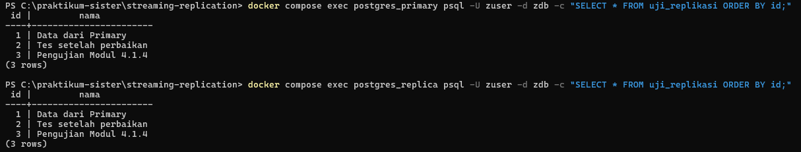
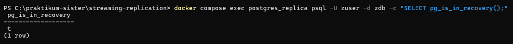

[Kembali](README.md) 
Praktikum Sistem Terdistribusi Dan Terdesentralisasi  
Modul 04 
Nama: Basilius Rivalno 
NIM: 255410027 
Dosen: Dr. Bambang Purnomosidi D. P 

<b>Pengujian replikasi</b>

1. Menguji apakah status replica dalam server standby

Tanda huruf t (True) artinya replica dalam mode standby yang hanya berfungsi untuk mereplikasi data dan menyediakan akses read bagi data

2. Menguji koneksi antara primary dan replica

Hasilnya menunjukkan primary memiliki koneksi aktif dengan replica

3. Melakukan pemeriksaan data pada primary dan replica

Hasil pemeriksaan menunjukkan dua baris yang sama ditampilkan pada primary dan replica yang artinya dua server tersebut saling terhubung

4. Menambahkan data baru pada primary

Menambahkan baris data atau baris ketiga pada server primary

5. Memeriksa data baru pada kedua server

Hasil menunjukkan penambahan data baru pada primary juga akan ditampilkan juga pada replica yang artinya data dari server primary berhasil diteruskan ke server replica menggunakan mekanisme <i>streaming replication</i>

6. pemeriksaan akhir status replica

Server replica masih dalam mode standby selama replikasi data
