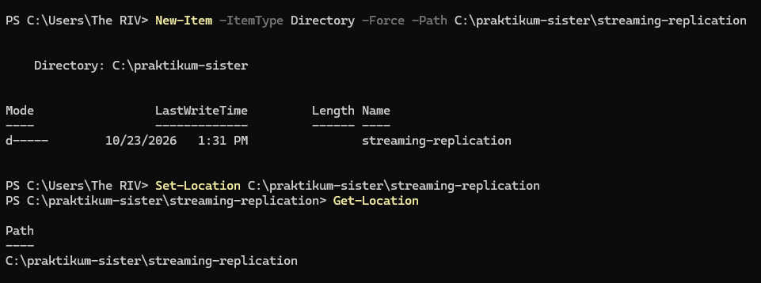
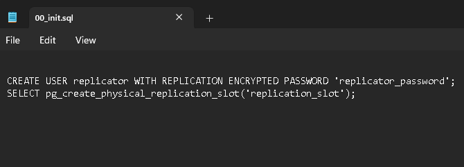

[Kembali](README.md)<br>
Praktikum Sistem Terdistribusi Dan Terdesentralisasi <br>
Modul 04<br>
Nama: Basilius Rivalno<br>
NIM: 255410027<br>
Dosen: Dr. Bambang Purnomosidi D. P<br>

<b>Struktur Direktori</b>

1. Membuat direktori streaming replication


2. Membuat file 00_init.sql


File ini berfungsi untuk membuat replikasi ke <i>Primary Server</i> beserta slot replikasinya<br>

3. Membuat file docker-compose.yaml

Kode yang akan disalin pada Notepad
```
x-postgres-common: &postgres-common
  image: postgres:18.3-alpine3.23
  user: postgres
  restart: always
  healthcheck:
    test: ["CMD-SHELL", "pg_isready -U zuser --dbname=zdb"]
    interval: 10s
    timeout: 5s
    retries: 5

services:
  postgres_primary:
    <<: *postgres-common
    ports:
      - "5432:5432"
    environment:
      POSTGRES_USER: zuser
      POSTGRES_DB: zdb
      POSTGRES_PASSWORD: zpass
      POSTGRES_HOST_AUTH_METHOD: "scram-sha-256"
      POSTGRES_INITDB_ARGS: "--auth-host=scram-sha-256"
    command:
      - postgres
      - -c
      - wal_level=replica
      - -c
      - hot_standby=on
      - -c
      - max_wal_senders=10
      - -c
      - max_replication_slots=10
      - -c
      - hot_standby_feedback=on
    volumes:
      - ./00_init.sql:/docker-entrypoint-initdb.d/00_init.sql
    networks:
      - postgres_network

  postgres_replica:
    <<: *postgres-common
    ports:
      - "5433:5432"
    environment:
      PGUSER: replicator
      PGPASSWORD: replicator_password
      PGDATA: /var/lib/postgresql/18/docker
    command:
      - bash
      - -c
      - |
        until pg_basebackup \
          --pgdata=/var/lib/postgresql/18/docker \
          -R \
          --slot=replication_slot \
          --host=postgres_primary \
          --port=5432 \
          -X stream; do
          echo 'pg_basebackup failed. Retrying in 5 seconds ...'
          sleep 5
        done
        echo 'Backup done, starting replica...'
        chmod 0700 /var/lib/postgresql/18/docker
        exec postgres
    depends_on:
      - postgres_primary
    networks:
      - postgres_network

networks:
  postgres_network:

 ```

