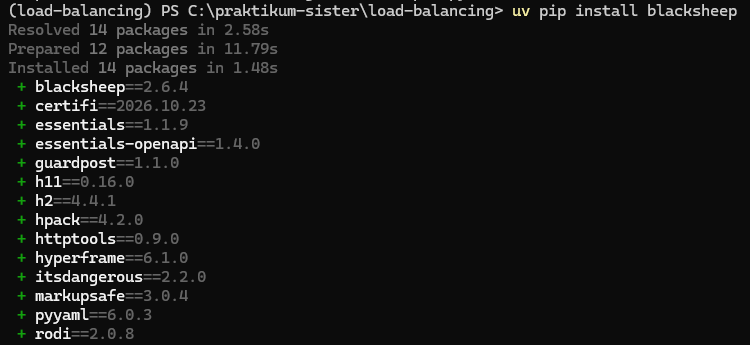
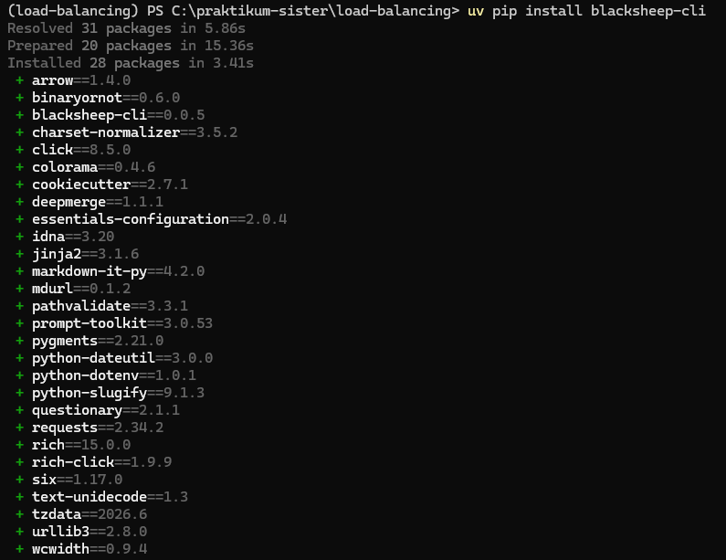
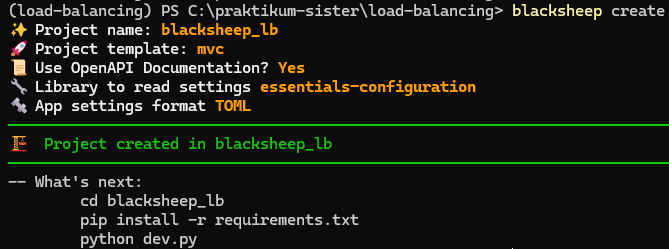
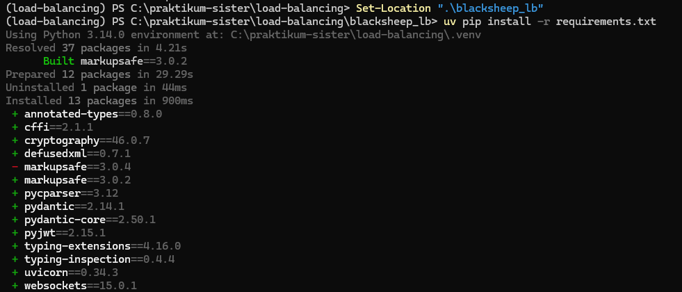
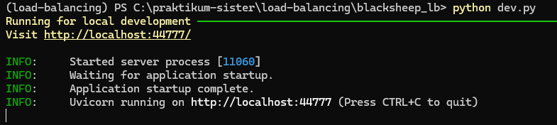
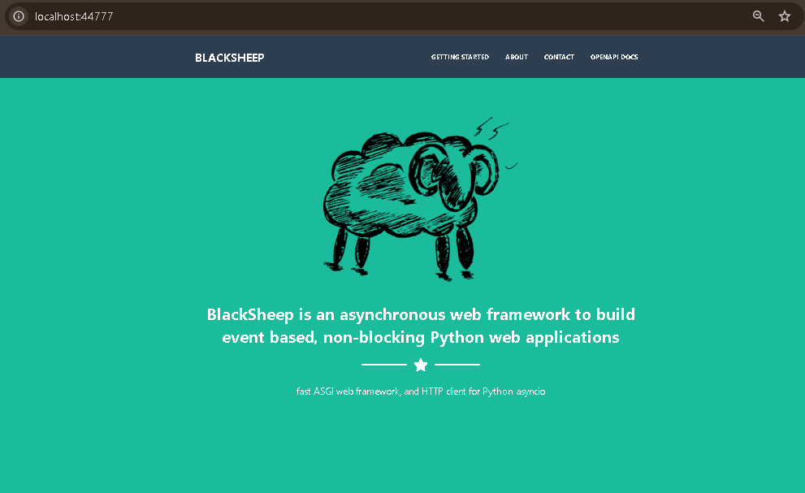
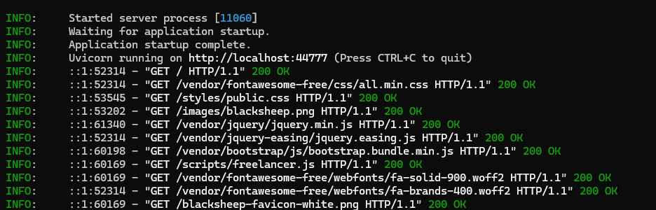

[Kembali](README.md) 
<b>Praktikum Sistem Terdistribusi Dan Terdesentralisasi</b> 
Nama: Basilius Rivalno 
NIM: 255410027  
Dosen: Dr. Bambang Purnomosidi D. P.

<b>Membuat Aplikasi Blacksheep</b>
1. Menginstal framework Blacksheep untuk membuat aplikasi melalui uv pada terminal

2. Membuat project Blacksheep

3. Memasang beberapa paket dalam folder project Blacksheep

4. Menguji apakah aplikasi dapat berjalan dengan baik

5. Membuka aplikasi melalui browser dengan alamat http://localhost:44777/

6. Mengecek terminal tempat menjalankan server

