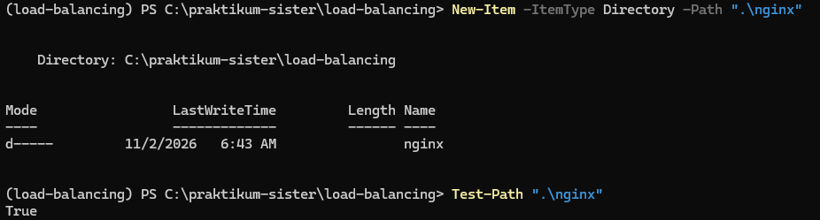
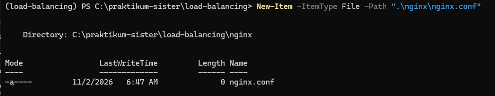
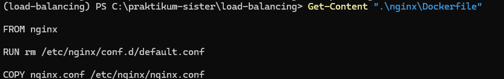
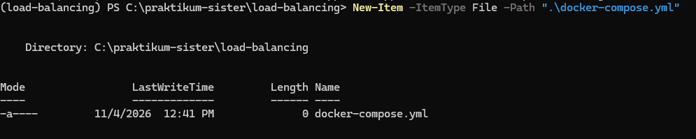
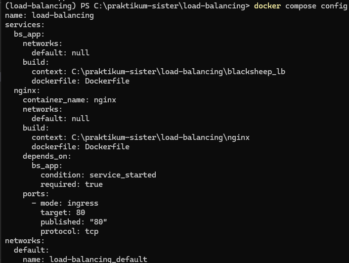

[Kembali](README.md)<br>
<b>Praktikum Sistem Terdistribusi Dan Terdesentralisasi</b><br>
Nama: Basilius Rivalno<br>
NIM: 255410027 <br>
Dosen: Dr. Bambang Purnomosidi D. P.

<b>Membuat Komponen Nginx Dan Docker Compose.yml</b><br>

1. Membuat folder nginx


2. Membuat file nginx.conf


3. Memasukkan konfigurasi
```

events {
    worker_connections 4096;
}

http {
    # Grup server aplikasi yang menerima pembagian request
    upstream backend {
        server bs_app:80;
    }

    server {
        listen 80;

        location / {
            proxy_pass http://backend;
        }
    }
}
```
4. Membuat image nginx agar dapat dijalankan docker


5. Membuat file docker compose yml


6. Memasukkan kode kedalam file docker tersebut
```
services:
  bs_app:
    build: ./blacksheep_lb

  nginx:
    container_name: nginx
    build: ./nginx
    ports:
      - "80:80"
    depends_on:
      - bs_app
```

7. mem validasi konfigurasi



