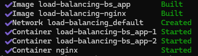
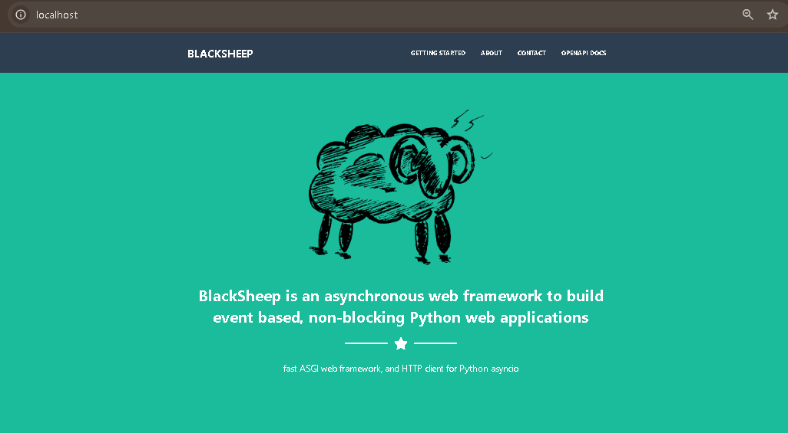
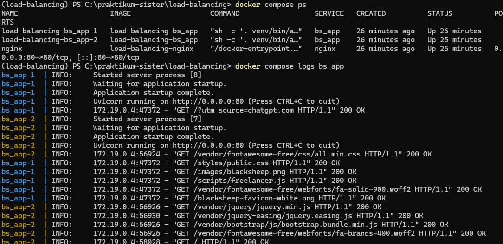

[Kembali](README.md) 
<b>Praktikum Sistem Terdistribusi Dan Terdesentralisasi</b> 
Nama: Basilius Rivalno 
NIM: 255410027  
Dosen: Dr. Bambang Purnomosidi D. P.

<b>Menjalankan dua replika menggunakan Docker Compose</b> 

1. membangun image dan menjalankan dua container

2. menjalankan aplikasi Blacksheep dari Browser

3. mengetes Load Balancing

hasilnya menunjukkan kedua aplikasi replika menerima request dari nginx