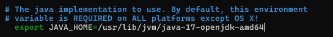
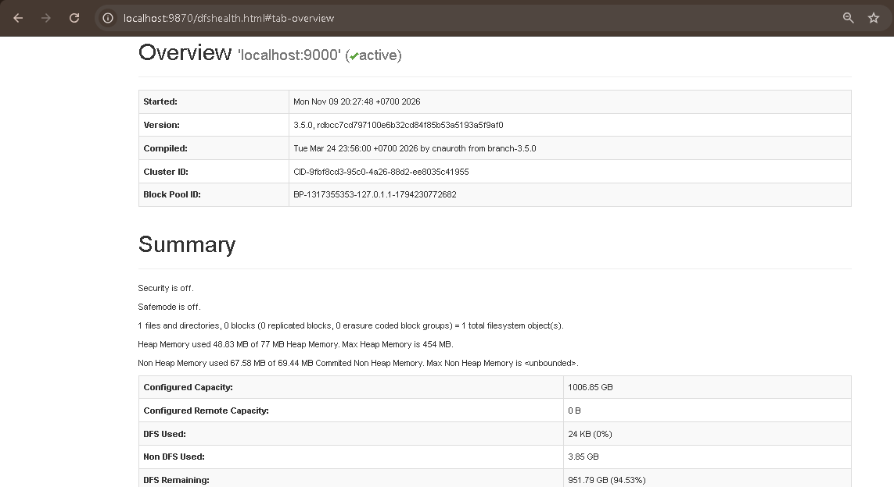
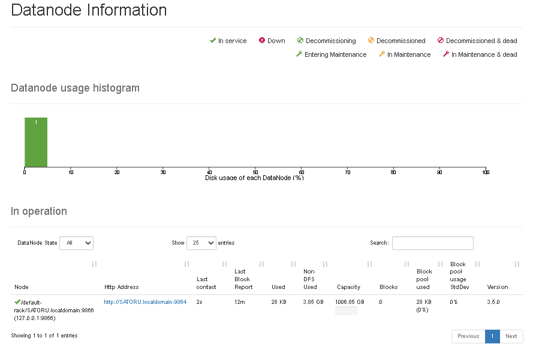

[Kembali](README.md) 
<b>Praktikum Sistem Terdistribusi Dan Terdesentralisasi Minggu 06</b> 
Nama: Basilius Rivalno 
NIM: 255410027 
Kelas: Informatika - 01 
Dosen: Dr. Bambang Purnomsidi D.P. 

1. Menjalankan HDFS dan mengecek daemon

2. Menjalankan web dengan url http://localhost:9870

web ini menampilkan kondisi NameNode dan informasi tentang penyimpanan data di cluster Hadoop.

3. Melihat node yang aktif
