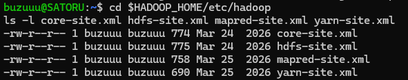
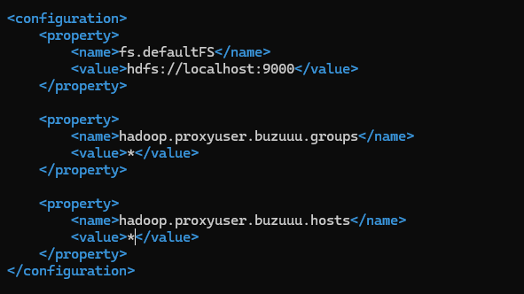
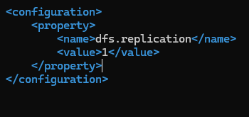
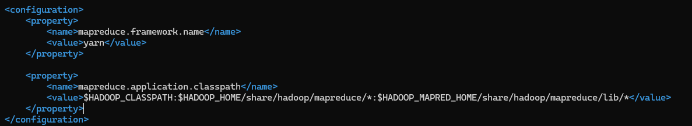
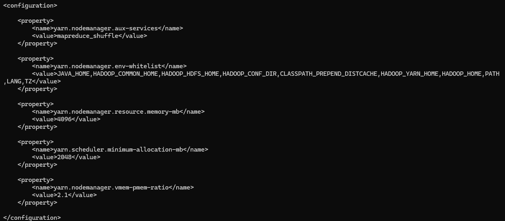
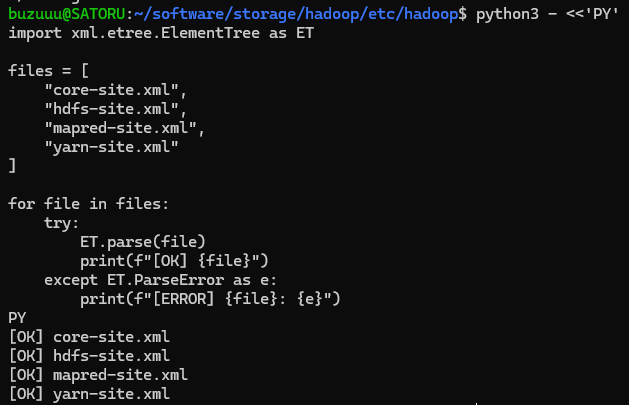

[Kembali](README.md) 
<b>Praktikum Sistem Terdistribusi Dan Terdesentralisasi Minggu 06</b> 
Nama: Basilius Rivalno 
NIM: 255410027 
Kelas: Informatika - 01 
Dosen: Dr. Bambang Purnomsidi D.P. 

1. Mengecek berkas konfigurasi

2. Konfigurasi core-site.xml

3. Konfigurasi hdfs-site.xml

4. Konfigurasi mapred-site.xml

5. Konfigurasi yarn-site.xml

6. Memeriksa konfigurasi

