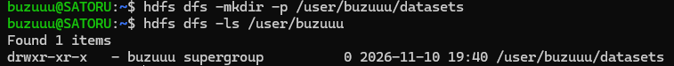
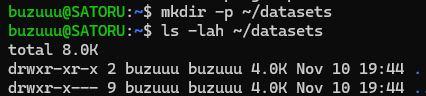
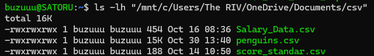
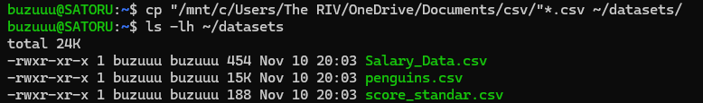
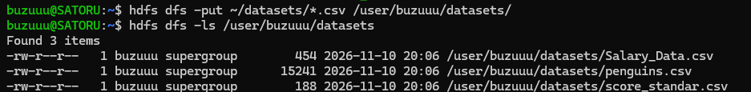

[Kembali](README.md) 
<b>Praktikum Sistem Terdistribusi Dan Terdesentralisasi Minggu 06</b> 
Nama: Basilius Rivalno 
NIM: 255410027 
Kelas: Informatika - 01 
Dosen: Dr. Bambang Purnomsidi D.P. 

1. Membuat direktori

2. Membuat direktori sementara pada ubuntu

direktori lokal ini dibuat untuk menyimpan file csv lalu mengunggah nya ke direktori Hadoop atau hdfs

3. Menyiapkan 3 file csv

4. Menyalin 3 file csv ke direktori lokal

5. Mengunggah 3 file csv dari direktori lokal ke hdfs
