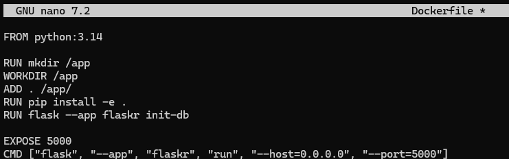
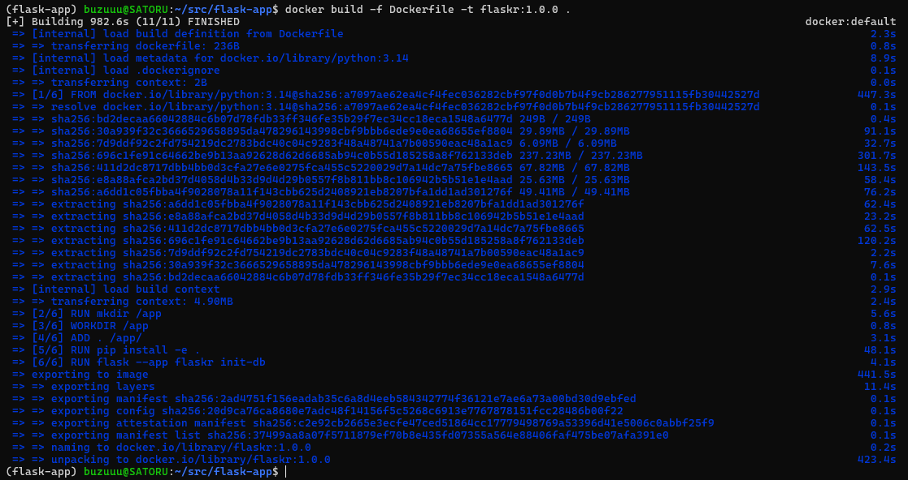
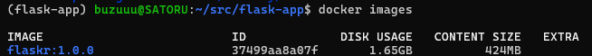
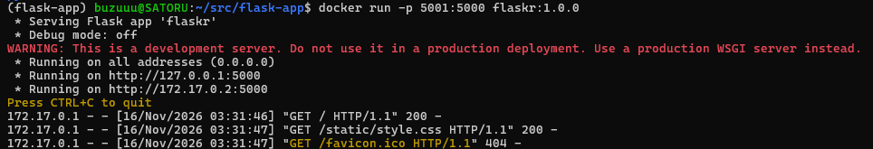
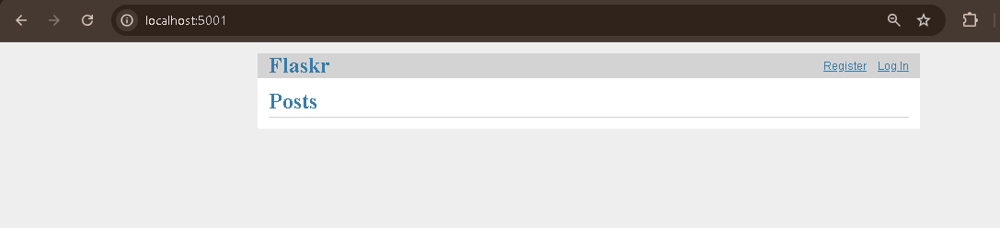

[Kembali](README.md)
<b>Praktikum Sistem Terdistribusi Dan Terdesentralisasi Minggu 07</b> 
Nama: Basilius Rivalno 
NIM: 255410027 
Dosen: Dr.Bambang Purnomosidi D. P. 

1. Membuat docker file

2. Membangun image

3. Verifikasi image

4. Menjalankan docker image

5. Mengakses lewat browser
