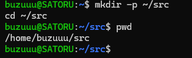
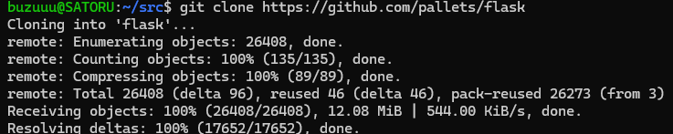
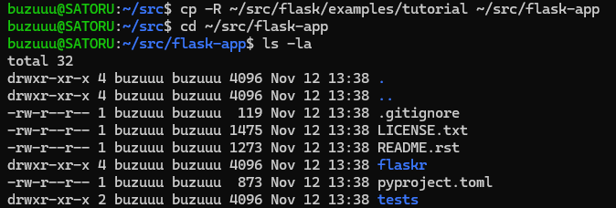
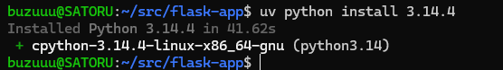
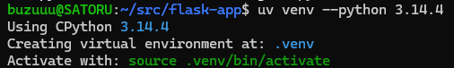
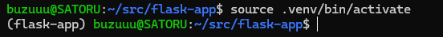

[Kembali](README.md)
<b>Praktikum Sistem Terdistribusi Dan Terdesentralisasi Minggu 07</b> 
Nama: Basilius Rivalno 
NIM: 255410027 
Dosen: Dr.Bambang Purnomosidi D. P. 

Membuat Environment Python
1. Membuat direktori agar disimpan di lingkungan Linux bukan Windows

2. Clone repository flask

3. Menyalin tutorial flask

Direktori flask app sudah berhasil dibuat 

4. Menginstal python melalui uv

5. Membuat virtual environment

6. Mengaktifkan virtual environment

