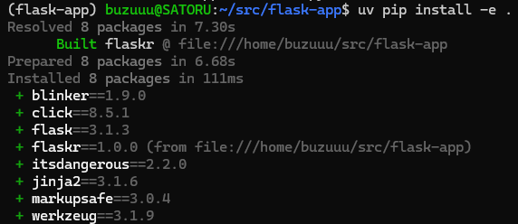
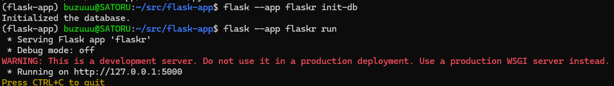
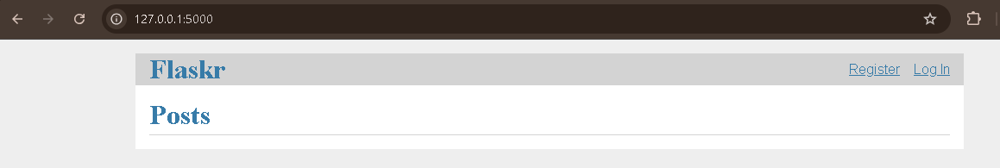

[Kembali](README.md)
<b>Praktikum Sistem Terdistribusi Dan Terdesentralisasi Minggu 07</b> 
Nama: Basilius Rivalno 
NIM: 255410027 
Dosen: Dr.Bambang Purnomosidi D. P. 

1. Install paket yang diperlukan

2. Inisialisasi database dan menjalankan aplikasi

Inisialisasi database SQLlite pada aplikasi flask lalu menjalankan nya pada browser dengan url http://127.0.0.1:5000. tampilan aplikasi seperti dibawah

