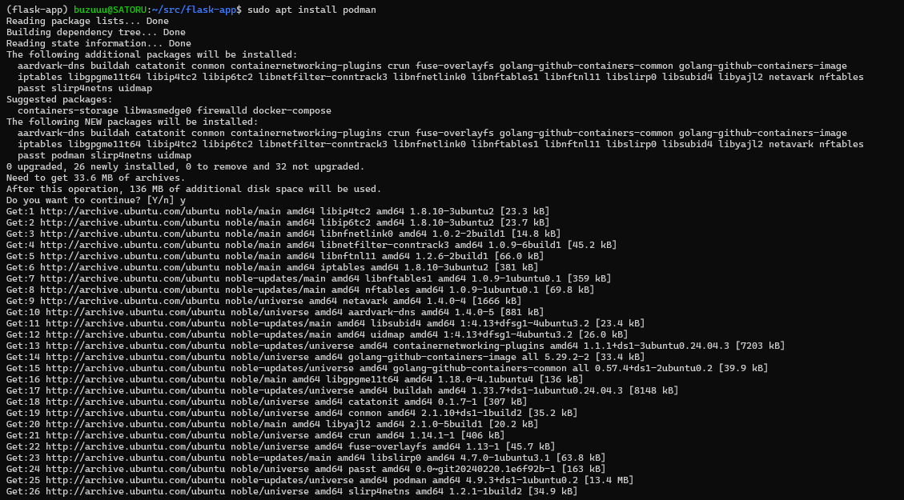
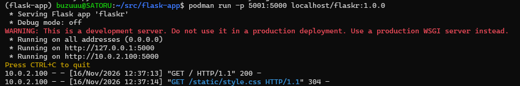
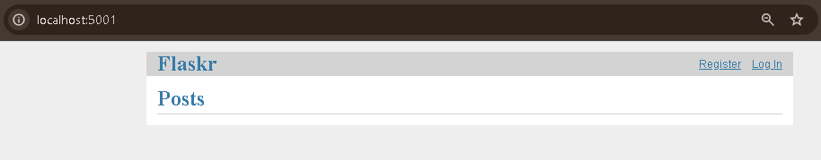

[Kembali](README.md)
<b>Praktikum Sistem Terdistribusi Dan Terdesentralisasi Minggu 07</b><br>
Nama: Basilius Rivalno<br>
NIM: 255410027<br>
Dosen: Dr.Bambang Purnomosidi D. P.<br>

1. Memasang podman


2. Membangun image
```
(flask-app) buzuuu@SATORU:~/src/flask-app$ podman build -f Dockerfile -t flaskr:1.0.0 .
STEP 1/8: FROM python:3.14
Resolved "python" as an alias (/etc/containers/registries.conf.d/shortnames.conf)
Trying to pull docker.io/library/python:3.14...
Getting image source signatures
Copying blob 411d2dc8717d done   |
Copying blob 696c1fe91c64 done   |
Copying blob e8a88afca2bd done   |
Copying blob a6dd1c05fbba done   |
Copying blob 30a939f32c36 done   |
Copying blob 7d9ddf92c2fd done   |
Copying blob bd2decaa6604 done   |
Copying config 78689ccd83 done   |
Writing manifest to image destination
STEP 2/8: RUN mkdir /app
--> 2bdfd25bc03a
STEP 3/8: WORKDIR /app
--> 9e8482695e2f
STEP 4/8: ADD . /app/
--> de8adedca405
STEP 5/8: RUN pip install -e .
Obtaining file:///app
  Installing build dependencies: started
  Installing build dependencies: finished with status 'done'
  Checking if build backend supports build_editable: started
  Checking if build backend supports build_editable: finished with status 'done'
  Getting requirements to build editable: started
  Getting requirements to build editable: finished with status 'done'
  Preparing editable metadata (pyproject.toml): started
  Preparing editable metadata (pyproject.toml): finished with status 'done'
Collecting flask (from flaskr==1.0.0)
  Downloading flask-3.1.3-py3-none-any.whl.metadata (3.2 kB)
Collecting blinker>=1.9.0 (from flask->flaskr==1.0.0)
  Downloading blinker-1.9.0-py3-none-any.whl.metadata (1.6 kB)
Collecting click>=8.1.3 (from flask->flaskr==1.0.0)
  Downloading click-8.5.1-py3-none-any.whl.metadata (2.6 kB)
Collecting itsdangerous>=2.2.0 (from flask->flaskr==1.0.0)
  Downloading itsdangerous-2.2.0-py3-none-any.whl.metadata (1.9 kB)
Collecting jinja2>=3.1.2 (from flask->flaskr==1.0.0)
  Downloading jinja2-3.1.6-py3-none-any.whl.metadata (2.9 kB)
Collecting markupsafe>=2.1.1 (from flask->flaskr==1.0.0)
  Downloading markupsafe-3.0.4-cp314-cp314-manylinux2014_x86_64.manylinux_2_17_x86_64.manylinux_2_28_x86_64.whl.metadata (2.7 kB)
Collecting werkzeug>=3.1.0 (from flask->flaskr==1.0.0)
  Downloading werkzeug-3.1.9-py3-none-any.whl.metadata (4.1 kB)
Downloading flask-3.1.3-py3-none-any.whl (103 kB)
Downloading blinker-1.9.0-py3-none-any.whl (8.5 kB)
Downloading click-8.5.1-py3-none-any.whl (126 kB)
Downloading itsdangerous-2.2.0-py3-none-any.whl (16 kB)
Downloading jinja2-3.1.6-py3-none-any.whl (134 kB)
Downloading markupsafe-3.0.4-cp314-cp314-manylinux2014_x86_64.manylinux_2_17_x86_64.manylinux_2_28_x86_64.whl (23 kB)
Downloading werkzeug-3.1.9-py3-none-any.whl (228 kB)
Building wheels for collected packages: flaskr
  Building editable for flaskr (pyproject.toml): started
  Building editable for flaskr (pyproject.toml): finished with status 'done'
  Created wheel for flaskr: filename=flaskr-1.0.0-py2.py3-none-any.whl size=2594 sha256=47c0f148b9717fb5f3986390ccadf4487d0561a452f54271dec55becb1bcfc0a
  Stored in directory: /tmp/pip-ephem-wheel-cache-9lf8x2ui/wheels/b8/36/9c/914153c626bda53913fc1c371da41560e7caf866363da7bf04
Successfully built flaskr
Installing collected packages: markupsafe, itsdangerous, click, blinker, werkzeug, jinja2, flask, flaskr

Successfully installed blinker-1.9.0 click-8.5.1 flask-3.1.3 flaskr-1.0.0 itsdangerous-2.2.0 jinja2-3.1.6 markupsafe-3.0.4 werkzeug-3.1.9
WARNING: Running pip as the 'root' user can result in broken permissions and conflicting behaviour with the system package manager, possibly rendering your system unusable. It is recommended to use a virtual environment instead: https://pip.pypa.io/warnings/venv. Use the --root-user-action option if you know what you are doing and want to suppress this warning.

[notice] A new release of pip is available: 26.2.2 -> 26.3
[notice] To update, run: pip install --upgrade pip
--> ce52150433cc
STEP 6/8: RUN flask --app flaskr init-db
Initialized the database.
--> db382b70b214
STEP 7/8: EXPOSE 5000
--> a3119284ba2a
STEP 8/8: CMD ["flask", "--app", "flaskr", "run", "--host=0.0.0.0", "--port=5000"]
COMMIT flaskr:1.0.0
--> 018f445913f3
Successfully tagged localhost/flaskr:1.0.0
018f445913f34fbb9db23290cd6b6b3fcb45df0648d3d8f2a1bf573966ac743a
```

3. Menjalankan url http://localhost:5001


4. Tampilan pada browser



